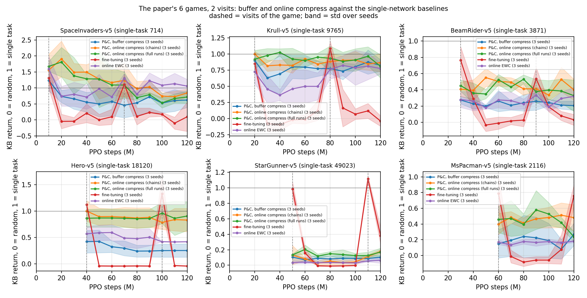

# Notes

Companion to the [README](README.md): maths, implementation details, detailed results and next steps.

## I. Discussion

---

Going through [Progress & Compress (Schwarz et al., ICML 2018)](https://arxiv.org/abs/1805.06370) first will make this section a lot more readable.

### Short summary

- The architecture is made of 1) active layers, 2) adaptors, 3) knowledge base (KB) layers (1 and 3 are also called "columns"). The adaptors let the active column read the KB features, layer by layer. Each column has one output head per task.
- For each task, perform a **"progress"** phase, where the **active layers and adaptors** are trained (cross-entropy for classification; PPO for RL) with the KB frozen, followed by a **"compress"** phase, where the **KB layers are trained** via distillation (KL divergence) from a teacher (see note below) plus a Mahalanobis regularization term. This regularization (online EWC) is a weighted L2 norm between the KB parameters and their values before the compress phase, where the weights come from the diagonal running Fisher matrix of the KB. The active column is re-initialized before each new task.

_Notes_:

- Per my (first) reading of the paper, during the compress phase, the teacher logits are obtained via the active layers only (no adaptors) and this is not what we want: the active column was trained with adaptor connections to the KB, and running it standalone produces different (weaker) logits. We implement three teacher variants (configurable via the `compress_teacher` key):
  1. `only_active_teacher`: the active layers alone, as in my first reading
  2. `moving_teacher`: the active layers with adaptors reading the KB while being trained, so the teacher drifts during the compress phase
  3. `frozen_teacher`: a frozen copy of the whole network after progress. **The most successful option.**

- It wasn't clear how the Fisher matrix was computed; I went with the (fully) empirical Fisher (see "Fisher derivations"). Each new Fisher matrix is clipped (optionally normalized) and added to the running Fisher with a decay $\gamma$. Note that the clip is what stops the SGD divergence (see I.3).

### I.1 Architecture details

**Forward pass**: the KB, adaptors and active layers are connected via:

$$h_i^{KB} = \sigma(W_i^{KB} h_{i-1}^{KB} + b_i^{KB})$$

$$h_i^{A} = \sigma(W_i^{A} h_{i-1}^{A} + b_i^{A} + \alpha_i \odot U_i \sigma(V_i h_{i-1}^{KB} + c_i))$$

- $W^{KB}, b^{KB}$ are KB parameters, $W^{A}, b^{A}$ are active layers' parameters and $\alpha_i, U_i, V_i$ the adaptors parameters
- The first layer has no adaptor: both columns read the input $x$.
- We experiment with `multi_head`: one linear head per task and per column (`multi_head=true`), meaning that we assume the task identity to be known (per the paper, it's meant to be fairly easy to identify task boundaries). A head is small (9k parameters for an 18-action Atari game, against 1.7 M in the KB backbone).
- The active column, its adaptors and its head are re-initialized before each task (following the paper).

**Progress loss**: Only $\theta^A$, $\phi$ ($\phi$: the adaptor parameters $\alpha, U, V, c$) and the active head get gradients; the KB is frozen. For classification: $l_{\text{progress}}(\theta^A, \phi) = -\mathbb{E}_{(x, y)}\log \mathrm{softmax}(z^A)_y$

For RL: the same parameters, trained by PPO's clipped objective (actor $z^A$ and critic on $h_L^A$) - using CleanRL directly.

**Compress loss**: $\theta^{KB}$ and the KB head get gradients. The teacher logits $z^T$ come from a frozen copy of the whole network after progress (see the note above), with no gradient:

$$l_{\text{compress}}(\theta^{KB}) = \tau^2 \mathrm{KL}(\mathrm{softmax}(z^T / \tau)||\mathrm{softmax}(z^{KB} / \tau)) + \frac{\lambda}{2} \sum_j \gamma F^\ast_j (\theta_j - \theta^\ast_j)^2$$

- $\theta^\ast$ = the KB parameters at the end of the previous compress phase; $F^\ast$ = the running diagonal Fisher with one entry per KB parameter, the heads excluded (the first task has no penalty because no running Fisher).
- One SGD step of this loss is `distill_step` in `src/utils.py`, shared by Omniglot and Atari. On Atari the expectation is over states visited by the KB policy and labelled by the teacher.

### I.2 From EWC to online EWC

This is a summary. Refer to the paper (section 4) for the notations and details.

**Eq (3)+(4):** Tasks are independent given $\theta$, so the posterior is a chain: the posterior after $k-1$ tasks is the prior for task $k$.

$$p(\theta | D_{1:k}) \propto p(\theta) \prod_{i=1}^{k} p(D_i | \theta) $$

$$p(\theta | D_{1:k}) \propto p(\theta | D_{1:k-1}) p(D_k | \theta) \qquad (4^\ast)$$

**Eq (5)+(6):** Use a Laplace approximation for each task's log-likelihood (where $\theta_i^\ast$ MAP, and $F_i$ fisher)

$$\log p(D_i | \theta) \approx \log p(D_i | \theta_{i}^{\ast}) - \frac{1}{2} (\theta - \theta_{i}^{\ast})^\top F_i (\theta - \theta_{i}^{\ast}) $$

$$l_k(\theta) = \log p(D_k | \theta) - \frac{\lambda}{2} \sum_{i \lt k} \Vert \theta - \theta_{i}^{\ast} \Vert^2_{F_i}$$

Problem: we need one $\theta_{i}^{\ast}$ and one $F_i$ per task so memory $O(k)$ (in addition to large $\theta$, $F$...)

**Eq (7):** Apply the approximation to $(4^\ast)$ recursively. If the posterior after $k-1$ tasks is Gaussian with mean $\theta_{k-1}^\ast$ and precision $F_{k-1}^\ast$ the new MAP is Gaussian (I didn't do the exact maths but seems classic: the product of two Gaussians is a Gaussian, the precisions add)

$$F_{k}^{\ast} = F_{k-1}^{\ast} + F_k$$

$$\theta_{k}^{\ast} = \arg\max_\theta \log p(D_k | \theta) - \frac{\lambda}{2} \Vert\theta - \theta_{k-1}^{\ast}\Vert^2_{F_{k-1}^{\ast}} $$

Only need to keep a running Fisher! Note that penalty is centered at the latest MAP (all previous tasks up to k-1)

**Eq (8):** The above assumes each task is seen once. If we revisit a task, we would add the Fisher again and the penalty would grow without bound. Use decay $\gamma \le 1$, both in the running sum and in the penalty.

$$F_k^\ast = \gamma F_{k-1}^\ast + F_k$$

**Conclusion**: In P&C, the penalty during compress:

$$l_{\text{compress}}(\theta_{KB}) = \tau^2 \mathrm{KL}(\pi_{\text{teacher}} \Vert \pi_{KB}) + \frac{\lambda}{2} \Vert\theta_{KB} - \theta_{k-1}^\ast\Vert^2_{\gamma F_{k-1}^\ast}$$

In our codebase we (optionally) add an entrywise clip of the diagonal Fisher (helps with SGD divergence, see I.3).

See `distill_step` in `utils.py`

### I.3 Fisher derivations

It was unclear to me how the Fisher was computed, here are the derivation and choices made.

**Definition**: The KB defines a categorical distribution over the classes (or actions), $p_\theta(y | x) = \mathrm{Categorical}(\mathrm{softmax}(z^{KB}))$. The Fisher information:

$$F(\theta) = \mathbb{E}_{x \sim p_{\text{data}}} \mathbb{E}_{y \sim p_\theta(y | x)} [ \nabla_\theta \log p_\theta(y | x) \nabla_\theta \log p_\theta(y | x)^\top ]$$

It's also the expected Hessian of $-\log p_\theta(y | x)$ **under the model**. We keep the diagonal only (similar to EWC) for memory /speed considerations, at the expense of ignoring correlations between weights.

$$F_j(\theta) = \mathbb{E}_{x} \mathbb{E}_{y \sim p_\theta(y | x)} [ (\partial_{\theta_j} \log p_\theta(y | x))^2 ]$$

Problem: the inner expectation is a sum over the classes, and the square is taken per class, so the gradients cannot be summed first. The exact diagonal needs $C$ backward passes per sample:

$$\mathbb{E}_{y \sim p_\theta(y | x)} [ (\partial_{\theta_j} \log p_\theta(y | x))^2 ] = \sum_{y=1}^{C} p_\theta(y | x) (\partial_{\theta_j} \log p_\theta(y | x))^2$$

Instead, we use the **empirical Fisher** (in Omniglot): take $y = y_{\text{true}}$ from the data, one backward per sample $\hat F_j = \frac{1}{N} \sum_{n=1}^{N} (\partial_{\theta_j} \log p_\theta(y_n | x_n))^2$

In Atari, we use **Monte Carlo Fisher**: sample $y_n \sim p_\theta(y | x_n)$ from the KB itself, same formula and same cost ( unbiased for the true Fisher).

See `empirical_fisher` in `src/utils.py` and `fisher_batches` in `src/run_atari.py`. Next step: optimize with per-sample gradients in one batch with `torch.func`.

The running Fisher is obtained by 1. normalising (optional-but the paper does) $F_k \leftarrow F_k / \sum_j F_{k,j}$, 2. clipping $F_{k,j} \leftarrow \min(F_{k,j}, c)$ and 3. running sum: $F^\ast_k = \gamma F^\ast_{k-1} + F_k$.

Note: Fisher entries can be heavy-tailed (the largest is about 1000 times the mean, for Omniglot: mean 0.002 to 0.004, max 1 to 3). The EWC term affects each weight by $\lambda F^\ast_j$, so with such a spread there is no good single $\lambda$: small enough for the largest entries not to make SGD diverge, the penalty is negligible on the typical weight ($\lambda F_{\text{mean}} \approx 0.3$ at $\lambda = 100$); large enough to constrain the typical weight, the largest entries explode. Clipping each entry at $c$ allows us to use higher $\lambda$ without divergence. (Normalising does not help: it rescales everything by the same factor).

Note, per Murphy (Probabilistic Machine Learning: Advanced Topics, https://probml.github.io/pml-book/book2.html), Section 6.4 (Natural gradient descent and Hessian-free optimization):

> The empirical Fisher does not work as well as the true Fisher [KBH19; Tho+19]. When we reach a flat part of parameter space where the gradient goes to zero, the empirical Fisher becomes singular and the algorithm gets stuck. The true Fisher marginalizes out $y$, so it can detect small changes in the output even on plateaus — this is why natural gradient methods escape plateaus better than standard gradient methods.

> An alternative is to compute $F$ exactly but solve for $F^{-1}g$ approximately via truncated conjugate gradient (CG), where each step uses efficient Hessian-vector products [Pea94]. This is called Hessian-free optimization [Mar10a], but can be slow due to many CG iterations per update.

The Monte Carlo Fisher was not tested on Omniglot; to be revisited.

**Beyond the diagonal (credits to Claude for this paragraph)**: on Atari, increasing the sample count did not improve these runs: more Fisher states (4096 or 8192 instead of 1024) did not reduce the drift in the 3-game runs. A direct test on the saved teachers of the 6-game run (`experiments/fisher_quadratic.py`, III.2) points at the approximation instead: the quadratic with the full Fisher predicts the policy KL of a compress move (median ratio 1.0), the diagonal quadratic under-prices it in most cases, by 10 to 50 times. This is evidence about the local approximation; it does not show that this is what causes the forgetting seen in training. The distillation moves the 1.6 M weights of the dense layer together, and a diagonal Fisher misses their correlations. Alternatives:

- **KFAC / block-diagonal curvature:** approximate Fisher or GGN with Kronecker-factored blocks per layer, capturing cross-parameter structure without a full $P \times P$ matrix.

- **Block-diagonal Hessian/Fisher proxies:** per-parameter-block second-order estimates, sometimes via Hessian-vector products.

- **Hutchinson / random probes:** stochastic trace or curvature estimates via HvPs or JVPs with Rademacher/Gaussian vectors $v$.

---

## II. Implementation details

### Code layout

`src/`

- `model.py`: the two-column models with adaptors: `CNNModel` (Omniglot) and `PCAgent` (Atari), plus `SingleAgent` (one network, for the fine-tuning and EWC baselines). One head per task, switched with `prep_for_task` / `switch`.
- `utils.py`: Fisher information (`empirical_fisher`, `task_fisher`, `accumulate_fisher`), the Mahalanobis penalty, `distill_step` (one compress step, shared by Omniglot and Atari), optimizer and frozen-teacher helpers.
- `run_omniglot.py`: entry point (Hydra). The loop over tasks: `progress`, `compress`, Fisher, re-evaluation on the previous tasks. Mostly my code.
- `run_atari.py`: entry point (Hydra) for Atari. Same loop; `progress` is CleanRL's PPO, `compress` distils on states visited by the KB policy. Based on CleanRL.
- `metrics.py`: `Stats` (per-epoch losses and metrics of one phase), evaluation, the `results.json` task entry, the wandb logger. Partly AI-generated.
- `viz.py`: plots from `results.json`. Fully AI-generated.
- `conf/omniglot.yaml`, `conf/atari.yaml`: flat Hydra configs, one comment per key.
- `environments/omniglot.py`: one alphabet = one task, local labels, 15 train / 5 test samples per character.
- `environments/atari.py`: one game = one task (envpool), full-game evaluation.

`experiments/`

- `sweep.sh`, `best.sh`: the Omniglot sweep and the final configuration. `round*.sh`, `confirm.sh` - the search rounds of section III.
- `atari_*.sh`: the Atari sweeps; `atari_single.sh` (single-task normalizer), `atari_paper2.sh` (the paper's 6 games), `atari_paper3_teachers.sh` (the same buffer runs under a new tag, which save the teachers of the online study), `atari_paper3_chains*.sh` and `atari_paper3_full.sh` (online compress).
- `parallel.sh`: runner sourced by the sweep scripts (all but `sweep.sh`): `run <tag> <overrides>`, skips a run whose `results.json` exists, `JOBS` runs in parallel.
- `parse_sweep.py`: summary table of a sweep directory. AI-generated.
- `plot_omniglot_final.py`: the Omniglot figure of III.1 (P&C against distillation without EWC). AI-generated.

`tests/`

- Unit tests of the model and the compress phase (frozen BatchNorm, no graph under `torch.no_grad()`, the Fisher sample cap, the compress optimizer). Run with `uv run python -m pytest tests -q`.

Outputs

- `outputs/<sweep>/<tag>/`: one Hydra run directory per run: `results.json`, `run.log`, `.hydra/`. Not tracked.
- `reference_outputs/`: the run directories and plots the numbers of this README come from. Do not overwrite.

### results.json

One file per run, written at the end by `run_omniglot.py` / `run_atari.py` (`task_log` / `task_log_atari` in `src/metrics.py`). Two keys:

- `config` - the resolved Hydra config of the run.
- `task_logs` - one entry per task, in order. Each entry has the per-epoch curves of both phases (`progress_losses`, `compress_losses`, split into `compress_kl_losses` and `compress_ewc_losses`), the Fisher summary (`fisher_total_mass`, `fisher_max`, `fisher_per_layer`, `running_fisher_total`), and the re-evaluation on every task seen so far, right after this task's compress phase: `re_eval_accs` on Omniglot, `re_eval_returns` / `re_eval_norm_returns` / `re_eval_kls` (KL to the teacher on round-0 states, see III.3) on Atari. The Atari entry also carries `game`, `revisit`, `random_return`, the active column's `progress_return` and `progress_curve`, and `compress_curve` (the KB's return during the online compress phase).

`parse_sweep.py` and `viz.py` read the json. A run with NaN in `compress_losses` diverged. On Atari, `re_eval_norm_returns` and the `parse_sweep.py` table normalize by the teacher (0 = random, 1 = the latest active policy of the game); the `viz.py --paper` plots and the tables of III.2 normalize by the single-task score.

---

## III. Results

We test 1) how much the KB forgets (Omniglot and Atari) and 2) positive transfer (Atari). All runs use 3 seeds unless said otherwise, mean +/- std. This section keeps the main findings; the per-game and per-seed numbers are in the run directories under `reference_outputs/`.

How to read the plots: one line per task, its score after each later task. A flat line means no forgetting (drop = forgetting). The level right after a task's own compress says how well the KB learned it. On Omniglot the score is the KB test accuracy (should ideally match the accuracy right after the task's own compress phase). On Atari it is the KB return normalized so that 0 = random and 1 = a network trained on that game alone. Atari budgets are in PPO steps (1 step = 4 frames).

### III.1 Omniglot

**Setup**:

- 10 alphabets = 10 tasks, the first 10 of a fixed random order of the 50 (the same for every seed; task 0 is Oriya, 46 characters). 15 train / 5 test samples per character.
- Architecture: 4-block CNN with one head per task (the evaluation knows the task identity; the paper uses no task-specific parameters), data augmentation, frozen teacher.
- `experiments/best.sh`: Adam lr 1e-3 for 400 progress epochs; SGD momentum 0.9, lr 0.01, 120 compress epochs; $\lambda$ 500, Fisher clip 0.01, $\gamma$ 0.99, $\tau$ 2. Found by a search of 181 runs at 5 tasks plus 15 confirmation runs (`round1.sh` to `round5.sh`, `confirm.sh`).
- Baseline: distillation without EWC ($\lambda=0$), with the same training procedure and task-specific heads.

**Main result**: the EWC penalty reduces forgetting. Between a task's own compress and the end of the run, the KB loses 0.07 of accuracy on average over tasks 0 to 8 (0.34 without the penalty); tasks 0 and 1 lose 0.14 and 0.21. Distillation has a minor cost on performance. No clear positive transfer at the end of training, but a learned KB does speed learning up (see _Transfer_ below).

Caveats: a fourth learned-KB run diverged at task 3, and on task 0 (both KBs random, the runs should agree) the pair differs by up to 0.10 -> high variance across runs. The final gain is small; the active column is close to the ceiling anyway. Distillation without EWC loses substantially more accuracy on earlier tasks.

Each marker shows the mean test accuracy across three seeds after a task's compress phase. Bands show one standard deviation across seeds. Neither the means nor the bands are smoothed. Both methods use the same task order and known task identity.

Regenerate the plots with `uv run python -m experiments.plot_omniglot_final`.

**Secondary results**, found while sweeping hyperparameters:

- _Need to train the teacher correctly_ At 50 progress epochs the active column underfits and it's only around epoch 600 that it saturates. A task learned with a low margin can be forgotten -> quality of the teacher is important.

- _Fisher clip_: without, we observed the SGD diverging and getting NaNs at $\lambda$ = 100 and above. With each entry clipped at 0.01, $\lambda$=500 to 1000 works at 5 tasks; at 10 tasks $\lambda$=1000 diverged in 1 of 3 seeds and $\lambda$=500 in 1 of 7 runs (see failures). Rescaling the Fisher to unit mass instead does not help. Note that this seems theoretically justified, although my intuition was really just to avoid a gradient clip counterpart to fight heavy tails.

- _Multi-head_: One shared classification head did not work: each alphabet has local labels 0 to n-1. Without augmentation the KB forgets 0.39 even with EWC (my guess: with 15 samples per class the KB memorizes, and the Fisher then protects the memorization)

- _Did not help_: a head warm-up at the start of compress, more compress epochs (120 is enough), a lower compress lr with more epochs, $\tau$ 1 or 4, $\gamma$ 0.5 to 1.0, a higher progress lr.

- _Transfer_: against a control with a frozen random KB (paired random streams, 3 seed pairs), the learned KB makes the active column learn a new alphabet faster (+6 points of accuracy at epoch 50) and end slightly higher (+1 point), on every seed. Caveat: a fourth learned-KB run diverged at task 3 + high variance across runs.

- _Some failures_: $\lambda$=1000 won the 5-task search but diverged in 1 of 3 seeds at 10 tasks whereas $\lambda$=500 ran clean on 3 of 3 in the final; in the transfer study, with other random streams, 1 of 4 learned-KB runs at $\lambda$=500 diverged at task 3, so $\lambda$ 500 is near the edge too. Tasks 0 and 1 end 0.14 and 0.21 below their accuracy after their own compress and I do not know why; alphabet size does not explain it.

Plots: `reference_outputs/plots/final/` (`accuracy_per_task.png`, the P&C runs alone; `compress_loss_split.png`, the KL and EWC terms per task: the two settle at the same order, 0.3 to 2, from task 3 on).

### III.2 Atari

_Note: The Atari report below (including language) was mostly ai-generated_

**Setup**:

- The paper's 6 games in the paper's order (Space Invaders, Krull, BeamRider, Hero, StarGunner, Ms. Pac-man), played twice: 2 visits of 10 M PPO steps per game, 12 tasks per run, 3 seeds. The paper does 5 visits of 12.5 M steps.
- Progress: CleanRL's PPO on the active column and the adaptors. Compress: distillation of a frozen copy of the agent into the KB, either on a fixed buffer of 65536 states (my first version) or online, on 5 M steps of rollouts of the KB policy per phase (the paper's way).
- Scores: greedy policy over 10 full games, normalized so that 0 = random and 1 = a network trained 10 M steps on that game alone.
- Baselines on the same 12 tasks: fine-tuning (one network, no penalty) and online EWC (one network, $\lambda$ 1e5). Every method has one actor head per game; the paper uses none.
- Scripts: `atari_single.sh` (the normalizer), `atari_paper3_teachers.sh` (buffer compress), `atari_paper3_full.sh` (online compress), `atari_paper2_baselines.sh`. Chains: `atari_paper3_chains.sh`, `atari_paper3_chains2.sh`. Controls: `atari_paper3_chains3.sh` (compress budget and penalty), `atari_pc_single.sh` (a random KB on each game alone).

**Main result**: the same EWC penalty reduces forgetting. The level of the KB is set by the compress phase, not by forgetting: distilling online on rollouts of the KB policy (as in the paper) nearly doubles what the KB gets from each teacher. No positive transfer.

Mean normalized KB return over the 6 games (in the plot: x = total PPO steps, dashed lines = the two visits of a game, a flat line = no forgetting):

| method | after visit 1 | after visit 2 |
|---|---|---|
| P&C, buffer compress | 0.36 $\pm$ 0.12 | 0.38 $\pm$ 0.06 |
| P&C, online compress, chains (same teachers as the buffer runs) | 0.66 $\pm$ 0.06 | 0.60 $\pm$ 0.08 |
| P&C, online compress, full runs | 0.68 $\pm$ 0.09 | 0.53 $\pm$ 0.10 |
| online EWC (one network) | 0.38 $\pm$ 0.04 | 0.47 $\pm$ 0.04 |
| fine-tuning (one network) | 0.16 $\pm$ 0.06 | 0.20 $\pm$ 0.09 |

**Main findings**:

- _Retention_: with the penalty, a game drifts by 0.1 to 0.2 (normalized) between its own compress and the end of the visit, a few game-seed pairs more; without it (fine-tuning) the game is lost at the next task. Online EWC retains about as well as P&C.
- _The compress phase is the bottleneck_: with the fixed buffer the KB reaches its teacher on Krull and Space Invaders only, and 0.1 to 0.4 of it on BeamRider, Hero and StarGunner. The online compress fixes most of it (0.36 to 0.68 after the first visit). Measured with controls, the gain comes from the online protocol first (fresh states, used once), the longer budget second, and not from the penalty setting.
- _Revisits_: at the second visit the KB moves towards its new teacher, and the second-visit teachers are often weaker. That is why the full online runs end at 0.53 where the chains, which reuse the buffer runs' teachers, end at 0.60.
- _StarGunner_ is never learned by the KB (0.17 of single-task on every variant): the distillation does not fit that teacher.
- _Transfer_: none established. The active column reaches 84 to 109 % of single-task on a new game whatever it has seen before, same as fine-tuning (the paper reports 125 to 129 %); online EWC drops to 5 to 77 %. Against the matched control (the same P&C architecture with a random KB, trained on each game alone), the sign is mixed by game: above on StarGunner, below on Krull and Hero, 82 to 166 % overall; the architecture alone scores 0.66 to 1.29 of one network depending on the game.

The gameplay animation of the README's Introduction was made with `experiments/atari_viz.sh` (the two runs, `checkpoint_every=250000`), `experiments/render_clips.py` (a greedy game per checkpoint) and `interactive_report/gameplay_animation.py` (the animation).

**Secondary results**:

- _The diagonal Fisher under-protects_: on saved checkpoints, the quadratic with the full Fisher predicts the policy drift of a compress move, the diagonal one under-prices it by 10 to 50 times. The missing cross terms are what the diagonal penalty lacks; a local test, which does not isolate the cause of the forgetting seen in training.
- _What transfers from Omniglot_: SGD with momentum for compress, the Fisher clip and the stability rule $\text{lr} \cdot \lambda \cdot \text{clip} \cdot n_{\text{tasks}} \approx 1$, greedy evaluation. $\lambda$ is 20 times larger here (the clip 10 times smaller).
- _Against the paper_: 2 visits of 10 M steps instead of 5 of 12.5 M, PPO instead of a distributed actor-critic, a greedy evaluation after each compress phase instead of the reward during compress, a frozen copy of the whole network as the teacher instead of the active column. The shape matches the paper's Figure 4; the numbers are not comparable.

### III.3 Reproducibility notes

- Seeds: Omniglot sets `torch.manual_seed` only; Atari also seeds numpy and the environments. `device: auto` picks CUDA, then MPS, then CPU on Omniglot; `src/run_atari.py` picks CUDA, then CPU. GPU kernels are not deterministic: numbers differ between machines and devices. Use `device=cpu` for an exact rerun.
- The SGD compress can diverge to NaN, after which the KB predicts one class. Check `compress_losses` in `results.json` before trusting a run. Read the level and the slope apart: a low level means the KB learned the task poorly; a flat curve means it forgot little afterwards. The Omniglot $\lambda$ 1000 runs (one NaN at task 7, seed 1) are not in the archive.
- Omniglot: the run directories of the 4 first configurations are in `reference_outputs/experiments/`, the 10-task final runs (`best_s*`, `ft_lam0_s*`) in `reference_outputs/experiments/final/`. The first configuration (`sgd_mom0.9_lam100`) is unstable on every device: the reference run did not diverge, a rerun on MPS and 2 of 5 reruns on CUDA did.
- Atari: every sweep's run directories are in `reference_outputs/atari/`, the online compress chains in `reference_outputs/atari/paper3/`. A run directory holds `results.json` (gzipped above 5 MB, which `viz.py` and `parse_sweep.py` read) and `run.log`; most also hold `.hydra/`. The teacher snapshots stay on the pod; those of the online study are the wandb artifacts `paper3_teachers_s{0,1,2}`.
- The Atari archive was produced by the entry point before the 2026-10-21 cleanup, `main_atari.py`. The refactored `src/run_atari.py` passes the 2-game smoke tests of both compress paths within the rerun spread of the old code (round-0 losses equal to 3 decimals); the fixed-batch comparison of gradients and updates is pending.
- The 3-game "final" runs are chains on saved PPO teachers, not full runs (10 min against 70 min). Those teachers were trained against a $\lambda$ 1e4 KB; the fine-tuning chains reuse them. The 6-game P&C runs are full runs.
- The evaluation is 10 greedy games and the per-game spread is large (Space Invaders teacher 530 $\pm$ 106 over seeds). A 0.1 difference on one game is noise.
- The KL to the teacher logged after each task (`re_eval_kls`, "held-out KL" in older logs) is measured on round-0 states: 2048 states of the first 128 steps after reset in each of 16 environments, taken from the round-0 buffer that the compress phase also trains on. A game lasts 800 to 3700 steps, so this KL favours early-game states and mixes the fitting error with later drift.
- The `results.json` files of the 4 sweep runs in `reference_outputs/experiments/` (not those in `final/`) predate the fields `fisher_per_layer`, `compress_kl_losses`, `compress_ewc_losses`. The training logic is the same.

---

## IV. Next steps

- Extension to Transformers and world models: can the distillation step compress what the model knows into a few "codebook" tokens, then keep learning new rules for new environments?
- Curriculum learning and the slow building of reusable representations ("circuits"), for example in robotics; unlikely to emerge from classification alone.
- Compress the active column into a sparse representation (lottery ticket hypothesis).
- With a generative model, a replay buffer of imagined experience is another route; evaluating a world model in latent space needs either a reconstruction term or the ability to plan from the latent.

## V. TO-DOs

- Faster Fisher computation (per-sample gradients in one batch with `torch.func`).
- Ablate the architecture itself (backbone, adaptor placement); none was done.
- Deferred to future work: diagnostic and Fisher states sampled across whole games instead of the first steps after reset. It is a method change that did not fit the budget. The published retention numbers rest on the greedy returns; the KL diagnostic is the one on round-0 states, labelled as such in III.2 and III.3.
