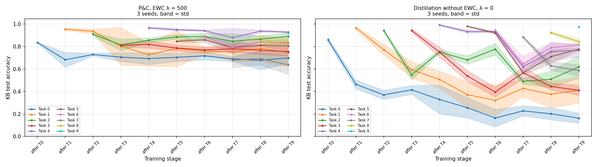
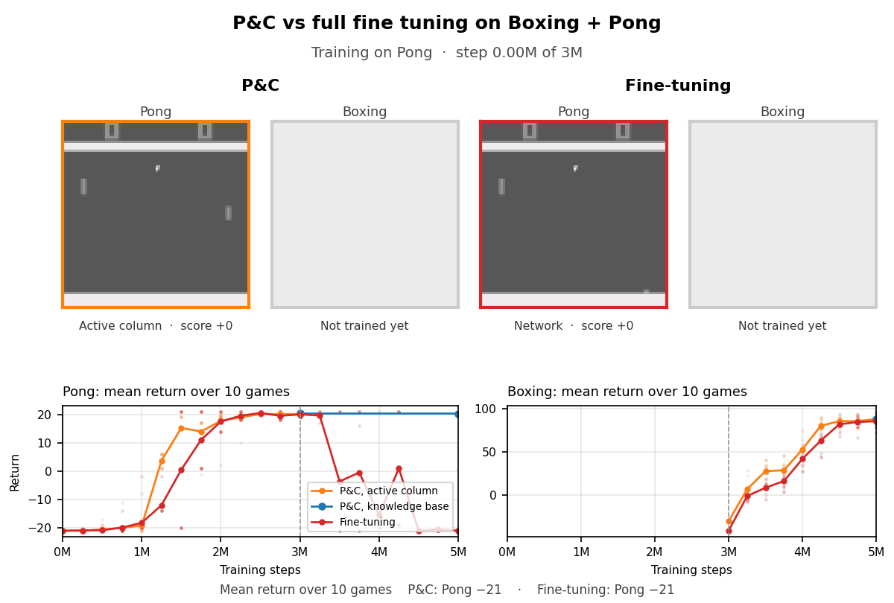
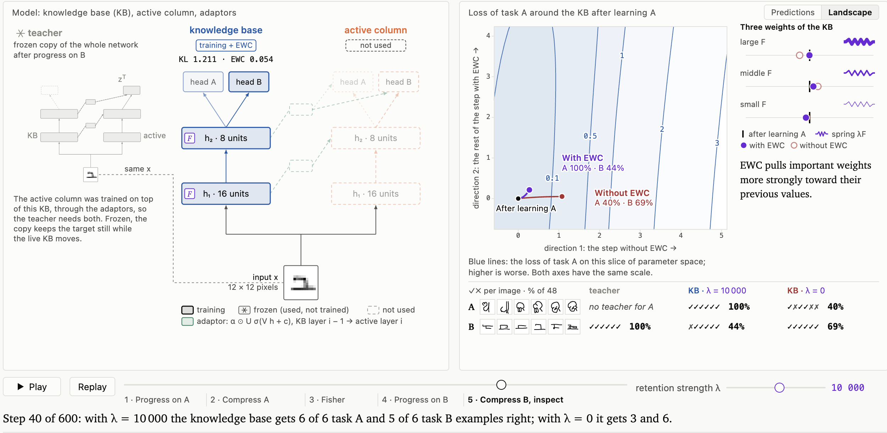

# progress-compress

## Introduction

A from-scratch implementation of [Progress & Compress (Schwarz et al., ICML 2018)](https://arxiv.org/abs/1805.06370) for continual learning, tested for 1) classification tasks on Omniglot (one alphabet = one task) and 2) Reinforcement learning on some selected Atari games.

**Context**:

- This is an entrypoint into Bayesian continual learning and wake-sleep algorithms. We wish to incorporate different tasks sequentially (e.g. new tasks arrive one after the other) into a learning algorithm, without suffering from catastrophic forgetting (and even ideally - showing positive transfer!). The key insight from Bayesian statistics (see Elastic Weight Consolidation) is that the posterior does not depend on task ordering and therefore is a candidate for continual learning (see the discussion in [NOTES.md](NOTES.md)).
- Progress and compress (P&C) consists in an architecture that interleaves "active layers" (learn a new task), "knowledge base" layers (meant to consolidate existing knowledge) and "adaptors" (information flow from active to knowledge base and the other way around). The active layers are trained with cross-entropy (Omniglot) or PPO (Atari), while the knowledge base remains frozen. The knowledge base is then trained via distillation with a Fisher penalty to avoid parameter drifting and keep high performance on known tasks. See [NOTES.md](NOTES.md), I, for details.

**Notes**:

- **Note that this is not an entirely faithful reproduction** of the original paper (we deviate in optimizer settings, exact architectural details). The goal being to reproduce qualitatively the results for further expansions, not the exact quantitative results.

- The `model`, `run_omniglot` and fisher derivations (`utils`) are mostly my own code. Boilerplate code (data, plots, metrics...) are ai-generated. I make a point of writing what's AI-generated vs what's not in the code.

- Note that this is not an optimized nor highly flexible codebase - the goal being to re-implement an existing idea (for extensions).

**Results (summary)**:


- **Omniglot**:
  - Forgetting: using 10 alphabets, the EWC penalty reduces forgetting of previous tasks. Previous-task accuracy ends at ~0.79 with the penalty (against 0.60 without). Distillation incurs a minor cost ~0.05 on the new task.
  - Transfer, against a random-knowledge-base control: higher early accuracy on a new alphabet (+6 points at epoch 50) across three successful seed pairs, and a small final gain (+1 point). See the caveats in [NOTES.md](NOTES.md), III.1.
  - Note: Variance of results (over 3 seeds) is high. Three elements were essential: 1) train the teacher long enough, 2) clip the Fisher matrix and 3) use one head per task (2-3 not used in the original paper - but note that their exact architectural details differ - see the discussion and results in NOTES.md).


- **Atari**: using the paper's 6 games (2 visits of 10 M steps, 3 seeds), we reproduce the paper qualitatively.
  - Forgetting: The knowledge base retains most of each game across the 11 later tasks (full fine-tuning loses it within one), with some drift before a revisit on a few game-seed pairs (high variance of results again).
  - The limiting factor is the compress phase rather than forgetting: distilling online on rollouts of the knowledge base (as in the paper) brings mean normalized return after the first visit from 0.36 to 0.68 and after the second from 0.38 to 0.53 to 0.60 (online EWC 0.47, fine-tuning 0.20). The gain comes from the online protocol first and the longer compress budget second; the penalty setting gives no consistent advantage online (see NOTES.md, III.2).
  - Some revisits reduce the knowledge base's score when the new teacher is weaker. Positive transfer is not clearly established on Atari: the active column reaches 89 to 109% of single-task on a new game regardless of the games seen before, as fine-tuning does (the paper reports 125 to 129%).

_Note: A short separate run, one seed, Pong for 3 M PPO steps then Boxing for 2 M, with the agents saved every 250 k steps. Each screen replays a greedy game of the agent saved at that step; the charts give the mean of 10 greedy games, since one game alone can be a lucky one. Both learn Pong, then both learn Boxing; fine-tuning forgets playing Pong, P&C's knowledge base keeps it_

---

## I. Setup

Dependencies are managed with [uv](https://docs.astral.sh/uv/) (Python 3.11).

```bash
uv sync                  # Omniglot
uv sync --extra atari    # + Atari (envpool, Linux only)
```

Run all commands from the repository root. Each run writes `results.json` and its `.hydra/` config to `outputs/<sweep>/<tag>/`. The sweep scripts skip a run if its `results.json` already exists.

### 1. Omniglot

Omniglot is downloaded to `./data` the first time you run the code. Omniglot experiments ran on my M2 Mac with MPS (and an RTX PRO 4500 for the larger sweeps).

```bash
# Run the sweep (4 configurations, see below)
bash experiments/sweep.sh
# Summary table
uv run experiments/parse_sweep.py outputs/experiments
# Plots
uv run src/viz.py outputs/experiments --out outputs/plots/experiments
# Optional - override the config with hydra
uv run src/run_omniglot.py max_n_tasks=5 multi_head=true ewc_lambda=100 hydra.run.dir=outputs/my_run
```

1. `sgd_mom0.9_lam100` -> base config: Adam for progress, SGD (momentum 0.9) for compress, $\lambda$ = 100
2. `adam_lam1000` -> ablation: Adam for compress (needs a larger $\lambda$)
3. `sgd_mom0.9_lam100_noaug` -> ablation: no data augmentation
4. `sgd_mom0.9_lam100_singlehead` -> ablation: one shared output head

The final result (NOTES.md, III.1) obtained with:

```bash
bash experiments/best.sh               # final config: lambda 500, Fisher clip 0.01, 400 progress epochs, 10 tasks, 3 seeds
bash experiments/omniglot_ft.sh        # baseline: the same runs with lambda 0 (distillation without EWC)
bash experiments/omniglot_transfer.sh  # transfer control: learned KB against a frozen random KB, paired random streams
uv run experiments/parse_sweep.py reference_outputs/experiments/final   # the 3-seed table (all_avg_acc, prev_avg_acc, current_acc)
uv run python -m experiments.plot_omniglot_final                         # the figure of the Introduction (written to outputs/plots/final/; the copy the README shows is in reference_outputs/plots/final/)
uv run python -m experiments.transfer_table outputs/experiments/final    # the transfer table, once the control runs exist
```

The archived run directories of these are in `reference_outputs/experiments/final/` (`transfer_table.py` writes the transfer table to `outputs/analysis/`).

### 2. Atari

The PPO loop is CleanRL's `ppo_atari_envpool.py`, see [CleanRL](https://github.com/vwxyzjn/cleanrl/blob/master/cleanrl/ppo_atari_envpool.py), with envpool for the environments. Atari experiments ran on an RTX PRO 4500 (32 GB, 13.6 vCPU) - mostly because of the good CPU/GPU ratio (the environments are simulated on CPU, and I didn't want to spend time optimizing things but just wanted an out-of-the-box RL pipeline).
_Note that envpool has no macOS wheel, so as-is, Atari runs on Linux only._

```bash
# Single-task runs (the normalizer of the plots), then P&C on the paper's 6 games, 2 visits, 3 seeds (~23 h per seed)
bash experiments/atari_single.sh
bash experiments/atari_paper2.sh
# Plots
uv run src/viz.py --paper "P&C=outputs/atari/paper2/pc_s0,outputs/atari/paper2/pc_s1,outputs/atari/paper2/pc_s2" --single outputs/atari/single --out outputs/plots/atari
# Optional - a short run with hydra overrides
uv run src/run_atari.py games=[Pong-v5,Boxing-v5] total_timesteps=[2000000,2000000] max_n_tasks=2 hydra.run.dir=outputs/my_run
```

### 3. Interactive report

A toy version of the whole method that runs in the browser (no install, no server needed): a small two-column model on Omniglot glyphs. Open `interactive_report/index.html` in a browser, or serve the folder:

```bash
python3 -m http.server 8765 --directory interactive_report
```

then open http://localhost:8765/. Details in `interactive_report/README.md`. Credits to Opus & Astra.



## II. Notes

The discussion, the implementation details, the full results and the next steps are in [NOTES.md](NOTES.md):

- I. Discussion -> the method, the architecture equations, from EWC to online EWC, the Fisher derivations and the clip
- II. Implementation details -> code layout, `results.json`
- III. Results -> Omniglot, Atari, reproducibility notes
- IV. Next steps, V. TO-DOs

## About the use of AI assistance

- I used AI assistance for visualizations, data generation, and checking my implementation against the paper. The design, architecture, and core logic are mine (you can probably tell if you look at the code...). The interactive report was fully AI-generated (with a lot of my edits...) and the Atari sweeps / code was AI-edited, started from CleanRL implementation.
- This README was checked for language/grammar and the results were brought together from summary table to markdown format (editing was AI-generated). The Atari report was generated by Claude Opus (with reviews from Astra).

## License and attribution

MIT (see `LICENSE`). The Atari PPO loop and the Nature CNN are adapted from [CleanRL](https://github.com/vwxyzjn/cleanrl) (MIT). Omniglot is the dataset of Lake, Salakhutdinov and Tenenbaum (2015), downloaded by the code. The interactive report was generated by Claude and Astra, in collaboration with their human editor.

## References / reading list

### Foundational

- [Progress & Compress (Schwarz et al., ICML 2018)](https://arxiv.org/abs/1805.06370)
- [Progressive Neural Networks (Rusu et al., 2016)](https://arxiv.org/abs/1606.04671) — the architecture P&C directly builds on
- [EWC: Overcoming Catastrophic Forgetting (Kirkpatrick et al., 2017)](https://arxiv.org/abs/1612.00796) — the forgetting mechanism P&C uses
- [Online EWC / quadratic penalties (Huszár, 2017)](https://arxiv.org/abs/1712.03847) — the theoretical basis for P&C's constant-cost Fisher trick

### Direct follow-ons

- [Progressive Prompts (Razdaibiedina et al., ICLR 2023)](https://arxiv.org/abs/2301.12314)
- [Reset & Distill (ICLR 2024)](https://arxiv.org/abs/2403.05066)
- [CompoFormer (NeurIPS 2024)](https://arxiv.org/abs/2411.11364)
- [Self-Composing Policies (ICML 2024)](https://proceedings.mlr.press/v235/malagon24a.html)
- [ProgLoRA (ACL Findings 2025)](https://aclanthology.org/2025.findings-acl.143/)
- [PCLR: Progressively Compressed LoRA (ICLR 2026)](https://openreview.net/forum?id=WdP1NVSzsz)
